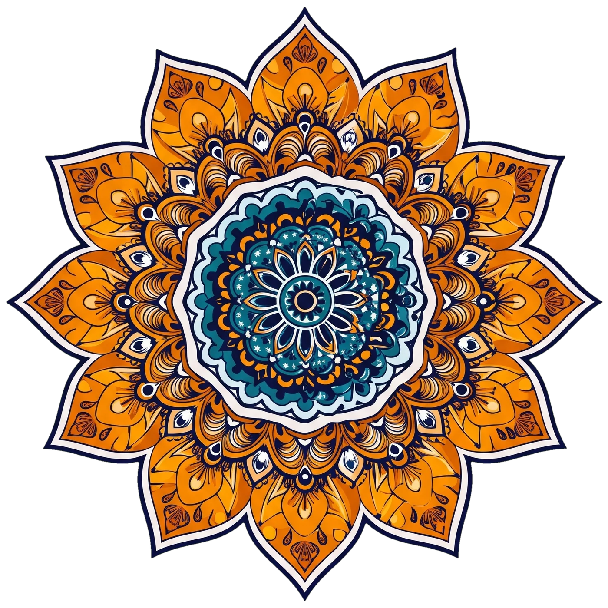

# Choyxona Menyusi — Fon Shablonlarini Boshqarish Qo'llanmasi 🎨✨

Ushbu qo'llanmada loyihadagi fon dizaynlari, mandalalar aylanishi, shablonlarni bir zumda almashtirish, parametrlarni sozlash va yangi shablonlar qo'shish bo'yicha to'liq yo'riqnoma keltirilgan.

---

## 📑 Mundarija
1. [Mavjud Shablonlar Tavsifi](#1-mavjud-shablonlar-tavsifi)
2. [1-usul: Bir Buyruq Bilan Avtomatik Almashtirish (Tavsiya etiladi)](#2-1-usul-bir-buyruq-bilan-avtomatik-almashtirish-tavsiya-etiladi)
3. [2-usul: Qo'lda (Manual) Almashtirish](#3-2-usul-qolda-manual-almashtirish)
4. [Aylanish Tezligi va Parametrlarni Sozlash](#4-aylanish-tezligi-va-parametrlarni-sozlash)
5. [Yangi Mandala va Fon Rasmlarini Tayyorlash](#5-yangi-mandala-va-fon-rasmlarini-tayyorlash)
6. [Jonli Ko'rish (Preview Sahifasi)](#6-jonli-korish-preview-sahifasi)
7. [Arxivdan Qayta Tiklash](#7-arxivdan-qayta-tiklash)

---

## 1. Mavjud Shablonlar Tavsifi

| Shablon | Ko'rinishi | Joylashuvi | Mandalalar | Fon Rasmi |
| :--- | :--- | :--- | :--- | :--- |
| **Shablon 1** | Klassik 4 burchakli | Ekran burchaklarida (TL, TR, BL, BR) | Har burchakda 2 tadan (jami 8 ta mandala) | Feruza fon (`bg.webp`) |
| **Shablon 2** *(Hozirgi faol)* | Zamonaviy sharqona | Chap tomon o'rtasida yarmi ko'rinuvchi | Orqada `Mandala 2` (teskari) + Ustida `Mandala 2.1` | Oq-kulrang sharqona geometrik fon |

---

## 2. 1-usul: Bir Buyruq Bilan Avtomatik Almashtirish (Tavsiya etiladi)

Loyihada shablonlarni `index.html`, `style.css` va rasmlar darajasida bir soniyada almashtirib beruvchi maxsus skript yaratilgan:

### 🔹 1-shablonga o'tish (4 burchakda mandala):
Terminalda (PowerShell yoki CMD) quyidagi buyruqni bering:
```bash
python tools/switch_template.py 1
```
*Bu buyruq avtomatik ravishda:*
- `index.html` ga 4 ta burchakli sahnani o'rnatadi.
- `style.css` da o'lchamlarni `--outer: clamp(300px, 64vmin, 960px)` ga moslaydi.
- 1-shablon rasmlarini faollashtiradi.

### 🔹 2-shablonga o'tish (Chap tomonda yarim ko'rinuvchi Mandala 2 + 2.1):
```bash
python tools/switch_template.py 2
```
*Bu buyruq avtomatik ravishda:*
- `index.html` ga chap tomon o'rtasidagi sahnani o'rnatadi.
- `style.css` da o'lchamlarni `--outer: clamp(520px, 94vmin, 1150px)` ga moslaydi.
- `mandala2.webp` va `mandala2.1.webp` hamda `bg.webp` ni faollashtiradi.

---

## 3. 2-usul: Qo'lda (Manual) Almashtirish

Agar fayllarni o'zingiz qo'lda o'zgartirmoqchi bo'lsangiz:

### 1-qadam: `index.html` dagi `<body>` boshlanishini tahrirlash

#### 👉 Shablon 1 uchun kod:
```html
  <!-- ================= BG SCENE (1-shablon) ================= -->
  <div class="bg-scene" aria-hidden="true">
    <div class="corner tl">
      
      
    </div>
    <div class="corner tr">
      
      
    </div>
    <div class="corner bl">
      
      
    </div>
    <div class="corner br">
      
      
    </div>
    <div class="bg-frame"></div>
  </div>
```

#### 👉 Shablon 2 uchun kod:
```html
  <!-- ================= BG SCENE (2-shablon) ================= -->
  <div class="bg-scene" aria-hidden="true">
    <div class="mandala-side-left">
      
      
    </div>
    <div class="bg-frame"></div>
  </div>
```

---

### 2-qadam: `style.css` dagi o'lchamlarni moslash

`style.css` boshidagi `:root` bo'limida quyidagi qiymatlarni o'zgartiring:

#### Shablon 1 uchun:
```css
:root {
  --outer: clamp(300px, 64vmin, 960px);
  --inner-ratio: 0.5;
}
@media (max-width: 768px) {
  :root {
    --outer: clamp(220px, 70vmin, 420px);
  }
}
```

#### Shablon 2 uchun:
```css
:root {
  --outer: clamp(520px, 94vmin, 1150px);
  --inner-ratio: 0.72;
}
@media (max-width: 768px) {
  :root {
    --outer: clamp(340px, 88vmin, 620px);
  }
}
```

---

## 4. Aylanish Tezligi va Parametrlarni Sozlash

Mandalalar aylanishi CSS transform va `bg-rotate.js` orqali boshqariladi.

### Aylanish yo'nalishi va tezligini o'zgartirish (`style.css`):
`style.css` ning `BG SCENE` bo'limida:
```css
/* Orqadagi mandala: soat strelkasiga TESKARI */
.bg-scene .mandala.mandala-back,
.bg-scene .mandala.outer {
  transform: rotate(calc(var(--r, 0) * -0.10deg));
}

/* Ustidagi mandala: soat strelkasi BO'YICHA */
.bg-scene .mandala.mandala-front,
.bg-scene .mandala.inner {
  transform: rotate(calc(var(--r, 0) * 0.16deg));
}
```
- Tezroq aylantirish uchun `0.10deg` yoki `0.16deg` o'rniga kattaroq son qo'ying (masalan, `0.25deg`).
- Sekinroq aylantirish uchun kichikroq son qo'ying (masalan, `0.05deg`).
- Agar ishorasini almashtirsangiz (`-` yoki `+`), aylanish yo'nalishi teskarisiga o'zgaradi.

### Skroll silliqligi (Lerp) ni sozlash (`bg-rotate.js`):
[`bg-rotate.js`](file:///d:/sayt/choyxona/bg-rotate.js) faylidagi:
```javascript
current += diff * 0.1; // 0.1 — inersiya tezligi (0.05 sekin/og'ir, 0.2 tez)
```

---

## 5. Yangi Mandala va Fon Rasmlarini Tayyorlash

Agar magenta (#FF00FF) fondagi yangi mandala yoki yangi fon rasmi qo'shmoqchi bo'lsangiz:

1. Rasmlarni `images/` papkasiga joylashtiring (masalan `images/mandala3.jpg` va `images/bg3.jpg`).
2. [`tools/prepare_assets.py`](file:///d:/sayt/choyxona/tools/prepare_assets.py) skripti orqali qayta ishlang:
   - Skript avtomatik ravishda tashqi magentani qirqadi (flood fill);
   - Halo bo'lmasligi uchun 1 px eroziya qiladi va feather beradi;
   - Magenta spillni yo'qotadi;
   - Kvadratga markazlashtirib, 1400x1400 px WebP (&le; 500 KB) formatiga keltiradi;
   - Fon rasmini 1920 px kenglikka proporsional WebP holatiga keltiradi.

---

## 6. Jonli Ko'rish (Preview Sahifasi)

Har qanday o'zgarishdan so'ng natijani tekshirish uchun:
- Brauzeringizda [`tools/preview.html`](file:///d:/sayt/choyxona/tools/preview.html) faylini oching.
- Unda interaktiv slayd va skroll yordamida mandalalar aylanishini, markazlashuvini va halo yo'qligini jonli kuzatishingiz mumkin.

---

## 7. Arxivdan Qayta Tiklash

Loyihaning 1-shablondagi dastlabki to'liq ishchi holati arxivlangan:
- **Arxiv jildi:** [`archive/shablon-1/`](file:///d:/sayt/choyxona/archive/shablon-1)
- **Arxiv fayli:** [`archive/shablon-1.zip`](file:///d:/sayt/choyxona/archive/shablon-1.zip)

Istalgan paytda ushbu zip fayldan nusxa olib, dastlabki holatni to'liq qayta tiklash mumkin.

---

> [!NOTE]
> Saytdagi asosiy admin tizimi, taomlar filtrlash, lightbox va savat kodi [`script.js`](file:///d:/sayt/choyxona/script.js) da joylashgan bo'lib, fon shablonlari uni o'zgartirmaydi. Yangi kodlar faqat [`bg-rotate.js`](file:///d:/sayt/choyxona/bg-rotate.js) va [`style.css`](file:///d:/sayt/choyxona/style.css) dagi `BG SCENE` bo'limida saqlanadi.
